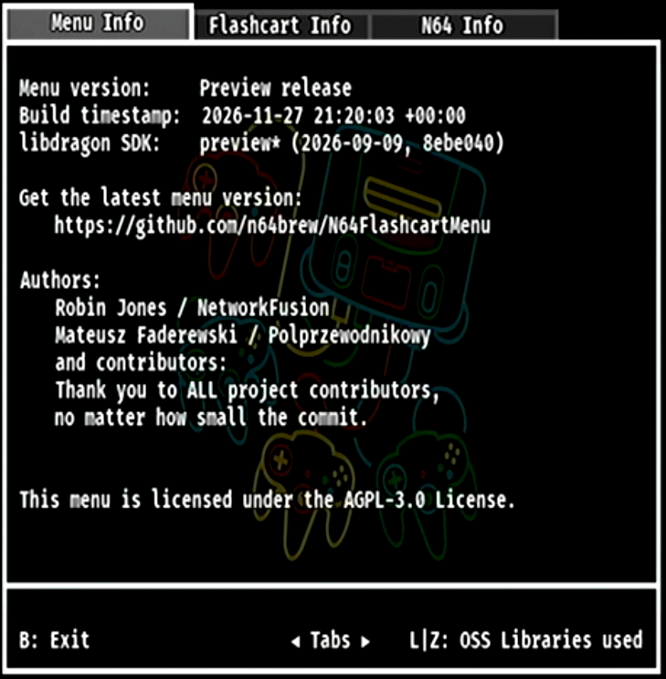
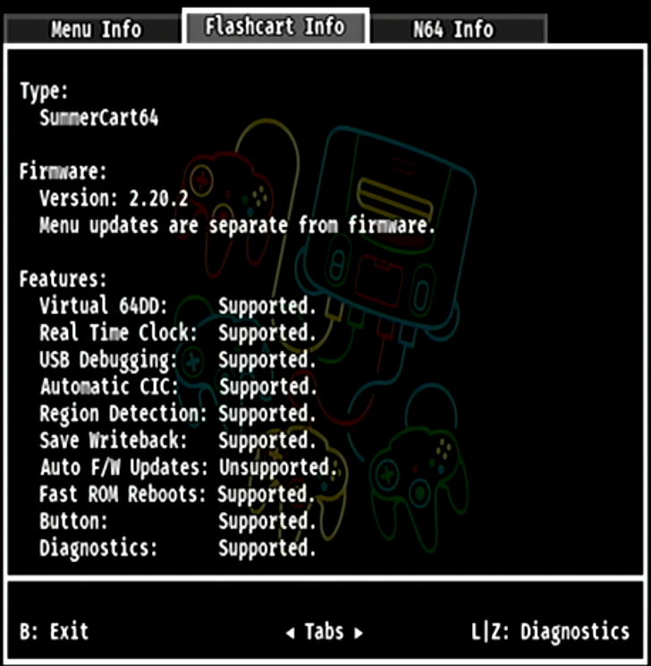
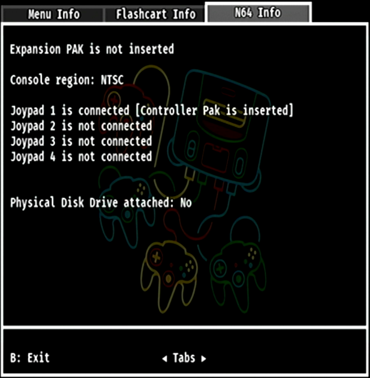

## Menu information
  
> [!NOTE]
> The three-tab information display is available in newer menu versions. Older versions show Menu, Flashcart, and N64 information as separate entries in the Settings menu.

This information display has three tabs. Use `D-Pad Left` and `D-Pad Right` to switch between Menu Credits, Flashcart Information, and N64 Information.

### Menu Credits
This tab shows the menu version, build date, developer credits, and licensing information. Press `L` or `Z` to see the open-source libraries used by the menu.

### Flashcart Information
This tab shows information about the flashcart, including its firmware version and supported features. The information shown depends on the flashcart in use.

On flashcarts that support diagnostics, press `L` or `Z` to view the current button state, voltage, and temperature.

### N64 Information

This tab shows information about the N64 console, including the Expansion Pak, Controller Pak ports and accessories, console region, and whether a physical 64DD is attached.
